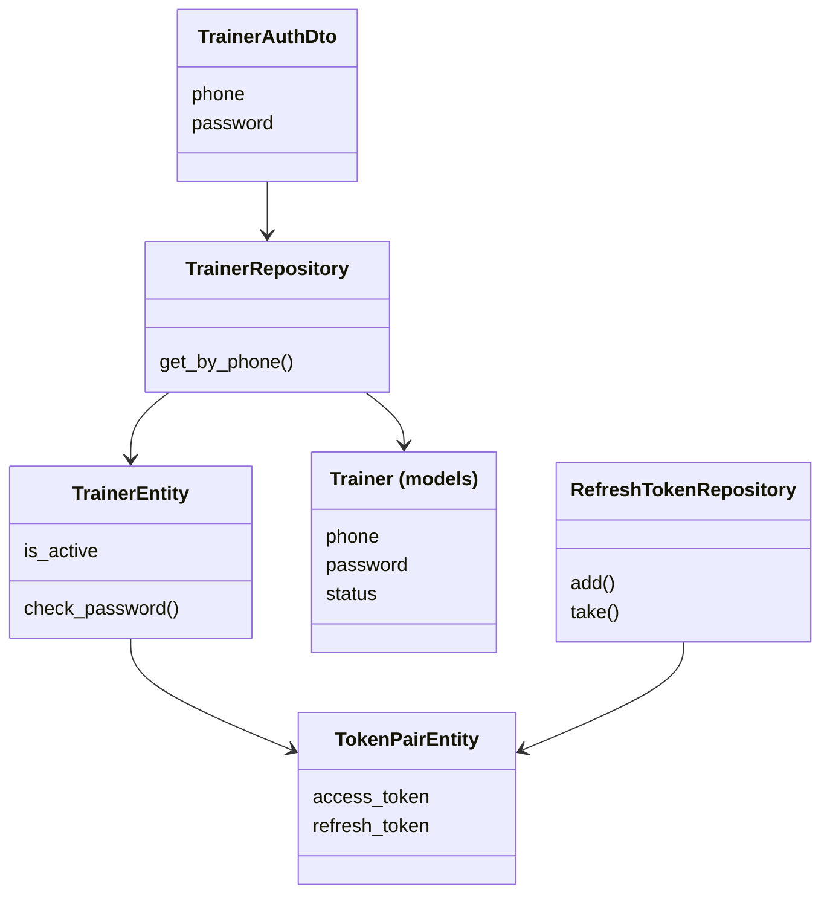

# Уровень 4. Код

Классы и структуры данных компонентов из [уровня 3](components.md). Описываются только ключевые и сложные места:
остальное видно в коде и быстро устаревает в документации.

## Тренер

Сценарий входа. `TrainerEntity` проверяет пароль. Модель `Trainer` хранит строку и правил не содержит.

