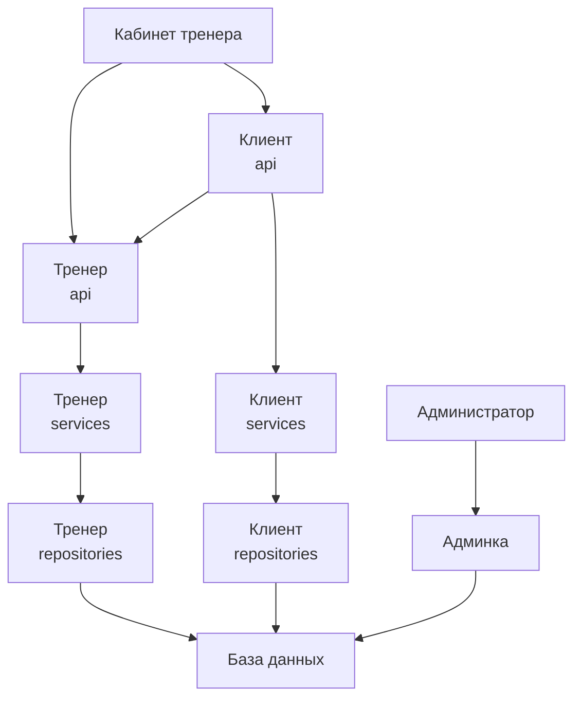

# Уровень 3. Компоненты

Внутреннее устройство контейнеров из [уровня 2](containers.md). Ниже разобран контейнер API. Решение о слоях —
[ADR 0011](../adr/0011-domain-layers.md).

## API

Домен — приложение Django в `backend/`. У тренера и клиента одни и те же пакеты: `api`, `dto`, `services`, `entities`,
`repositories`, `models`. В `models` каждая таблица — отдельный модуль, без правил в методах.

- **Компонент:** Тренер. **Ответственность:** Вход в кабинет, токен доступа и токен обновления. Пакет
  `trainers/`. **Зависит от:** База данных
- **Компонент:** Клиент. **Ответственность:** Список клиентов своего тренера. Пакет `clients/`. **Зависит от:** Тренер
- **Компонент:** Админка. **Ответственность:** Учётка тренера в Django Admin, модуль `trainers/admin.py`. **Зависит
  от:** Тренер

