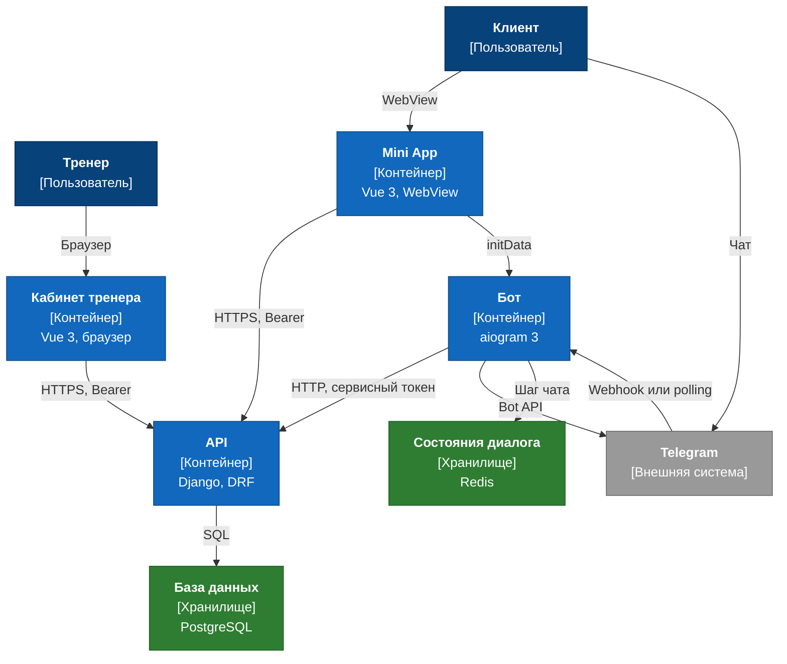

# Уровень 2. Контейнеры

Из каких отдельно запускаемых приложений и хранилищ состоит Trenly и как они связаны. Внешние системы и пользователи — из [контекста](context.md).

Решение по боту — [ADR 0006](../adr/0006-telegram-bot-aiogram.md). Mini App — отдельный HTTP-клиент API Django, решение — [ADR 0008](../adr/0008-client-mini-app.md).

## Контейнеры

| Контейнер | Назначение | Технологии | Папка |
|---|---|---|---|
| API | Домен, API кабинета тренера, API Mini App и внутренний API бота, админка | Python, Django, Django REST Framework | `backend/` |
| Кабинет тренера | Веб-интерфейс тренера в браузере | Vue 3, TypeScript, PrimeVue | `frontend/dashboard/` |
| Mini App | Веб-интерфейс клиента внутри Telegram | Vue 3, TypeScript | `frontend/miniapp/` |
| Бот | Чат клиента: приём апдейтов Telegram и отправка сообщений | aiogram 3 | `tg_bot/` |
| База данных | Клиенты, анкеты, дневник, тренировки, рекомендации | PostgreSQL | — |
| Состояния диалога | Незавершённый шаг чата | Redis | — |

## Связи

| Откуда | Куда | Что передаётся | Протокол |
|---|---|---|---|
| Кабинет тренера | API | Действия тренера и чтение данных клиентов | HTTPS, JSON, Bearer |
| Mini App | API | Анкета, дневник, история тренировок, награды, графики и отчёт | HTTPS, JSON, Bearer |
| Mini App | Бот | `initData` в обмен на токен клиента. Данные экранов бот не проксирует | HTTPS, JSON |
| Бот | API | Действие клиента (`telegram_user_id`), выдача токена клиента и запрос исходящих сообщений | HTTP, JSON, сервисный токен |
| Telegram | Бот | Апдейт чата. Локально бот забирает сам (polling), в окружениях Telegram вызывает webhook | Bot API |
| Бот | Telegram | Текст и кнопки клиенту | Bot API |
| Бот | Состояния диалога | Текущий шаг чата | Redis |
| API | База данных | Доменные записи | SQL |
| API | OpenRouter | Фото еды и запрос оценки КБЖУ, с E7 | HTTPS |
| API | Yandex Object Storage | Фото еды, с E7 | S3 API |

## Диаграмма

