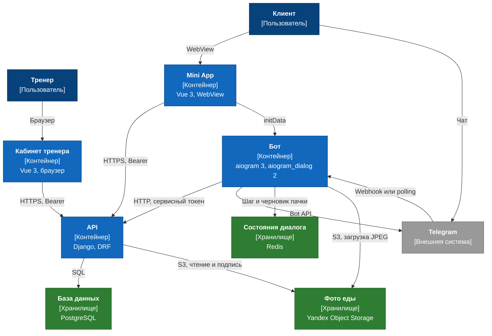

# Уровень 2. Контейнеры

Из каких отдельно запускаемых приложений и хранилищ состоит Trenly и как они связаны. Внешние системы и пользователи —
из [контекста](context.md).

Решение по боту — [ADR 0006](../adr/0006-telegram-bot-aiogram.md). Mini App — отдельный HTTP-клиент API Django, решение
— [ADR 0008](../adr/0008-client-mini-app.md). Внешний вид кабинета и Mini App задаётся макетом в Figma
([ADR 0009](../adr/0009-ui-design-figma.md)); Figma не контейнер Trenly и в рантайме не вызывается.

## Контейнеры

- **Контейнер:** API. **Назначение:** Домен, API кабинета тренера, API Mini App и внутренний API бота, админка.
  **Технологии:** Python, Django, Django REST Framework. **Папка:** `backend/`
- **Контейнер:** Кабинет тренера. **Назначение:** Веб-интерфейс тренера в браузере. **Технологии:** Vue 3, TypeScript,
  PrimeVue. **Папка:** `frontend/dashboard/`
- **Контейнер:** Mini App. **Назначение:** Веб-интерфейс клиента внутри Telegram. **Технологии:** Vue 3, TypeScript.
  **Папка:** `frontend/miniapp/`
- **Контейнер:** Бот. **Назначение:** Чат клиента: приём апдейтов Telegram и отправка сообщений. **Технологии:** aiogram
  3, aiogram_dialog 2. **Папка:** `tg_bot/`
- **Контейнер:** База данных. **Назначение:** Клиенты, анкеты, дневник, тренировки. **Технологии:** PostgreSQL.
  **Папка:** —
- **Контейнер:** Состояния диалога. **Назначение:** Шаг диалога и черновик незавершённой пачки. **Технологии:** Redis.
  **Папка:** —

## Связи

- **Откуда:** Кабинет тренера. **Куда:** API. **Что передаётся:** Действия тренера и чтение данных клиентов.
  **Протокол:** HTTPS, JSON, Bearer
- **Откуда:** Mini App. **Куда:** API. **Что передаётся:** Дневник и итог КБЖУ, ручной ввод КБЖУ, тренировки по дням,
  статистика посещений. **Протокол:** HTTPS, JSON, Bearer
- **Откуда:** Mini App. **Куда:** Бот. **Что передаётся:** `initData` в обмен на токен клиента. Данные экранов бот не
  проксирует. **Протокол:** HTTPS, JSON
- **Откуда:** Бот. **Куда:** API. **Что передаётся:** Действие клиента (`telegram_user_id`), ключ фото еды, выдача
  токена клиента и запрос исходящих сообщений. **Протокол:** HTTP, JSON, сервисный токен
- **Откуда:** Telegram. **Куда:** Бот. **Что передаётся:** Апдейт чата. Локально бот забирает сам (polling), в
  окружениях Telegram вызывает webhook. **Протокол:** Bot API
- **Откуда:** Бот. **Куда:** Telegram. **Что передаётся:** Текст и кнопки клиенту. **Протокол:** Bot API
- **Откуда:** Бот. **Куда:** Состояния диалога. **Что передаётся:** Шаг диалога и черновик пачки. **Протокол:** Redis
- **Откуда:** API. **Куда:** База данных. **Что передаётся:** Доменные записи. **Протокол:** SQL
- **Откуда:** API. **Куда:** OpenRouter. **Что передаётся:** Фото еды и запрос оценки КБЖУ, с E3. **Протокол:** HTTPS
- **Откуда:** Бот. **Куда:** Yandex Object Storage. **Что передаётся:** Сжатое фото еды, с E3. **Протокол:** S3 API
- **Откуда:** API. **Куда:** Yandex Object Storage. **Что передаётся:** Чтение фото для распознавания и подпись ссылок
  кабинету, с E3. **Протокол:** S3 API

## Диаграмма

