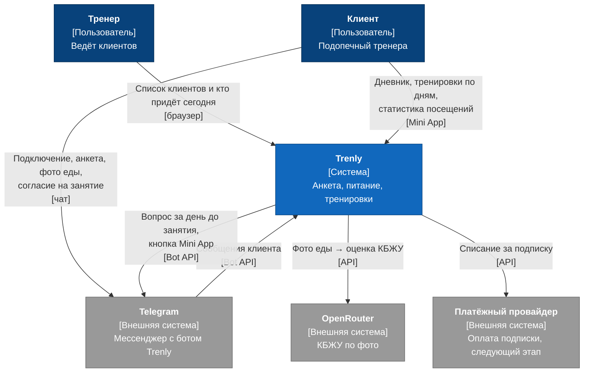

# Уровень 1. Контекст

Trenly — единая система, с которой работают тренер и клиент. Внутреннее устройство на этом уровне не показывается.

## Пользователи

| Пользователь | Описание | Как работает с Trenly |
|---|---|---|
| Тренер | Персональный фитнес-тренер. Учётку заводит администратор. | Веб-кабинет в браузере: список своих клиентов и кто придёт сегодня |
| Клиент | Подопечный тренера, подключён ровно к одному тренеру. Бесплатно. | Чат бота: подключение, анкета, фото еды, согласие на занятие. Mini App: дневник и итог КБЖУ, ручной ввод, тренировки по дням, статистика посещений |

## Система

| Система | Описание |
|---|---|
| Trenly | Взаимодействие тренера и клиента: подключение по ссылке, анкета в диалоге бота, дневник питания с КБЖУ, запись на занятие и согласие за день |

## Внешние системы

| Система | Зачем нужна | Взаимодействие | Когда появляется |
|---|---|---|---|
| Telegram | Канал клиента: чат бота и оболочка Mini App | Чат: Trenly ↔ Telegram Bot API. Mini App открывается в WebView Telegram и вызывает Trenly по HTTPS | E2 |
| OpenRouter (AI-модели) | Распознавание КБЖУ по фото еды. Модель не зафиксирована ([ADR 0004](../adr/0004-macros-recognition-openrouter.md)) | Trenly → OpenRouter API | E3 |
| Платёжный провайдер | Ежемесячное списание за подписку тренера ([BR-007](../../business/requirements.md#br-007-регистрация-тренера-и-подписка)) | Trenly → API провайдера, уведомления об оплате → Trenly | нет в роадмапе |

## Диаграмма

## Ключевые ограничения

- Персональные данные клиентов хранятся в РФ (152-ФЗ, [NFR-PRIV-003](../../nfr/privacy.md)).
- Передача фото во внешние AI-модели за пределами РФ — только после согласования с юристом ([NFR-PRIV-004](../../nfr/privacy.md)).
