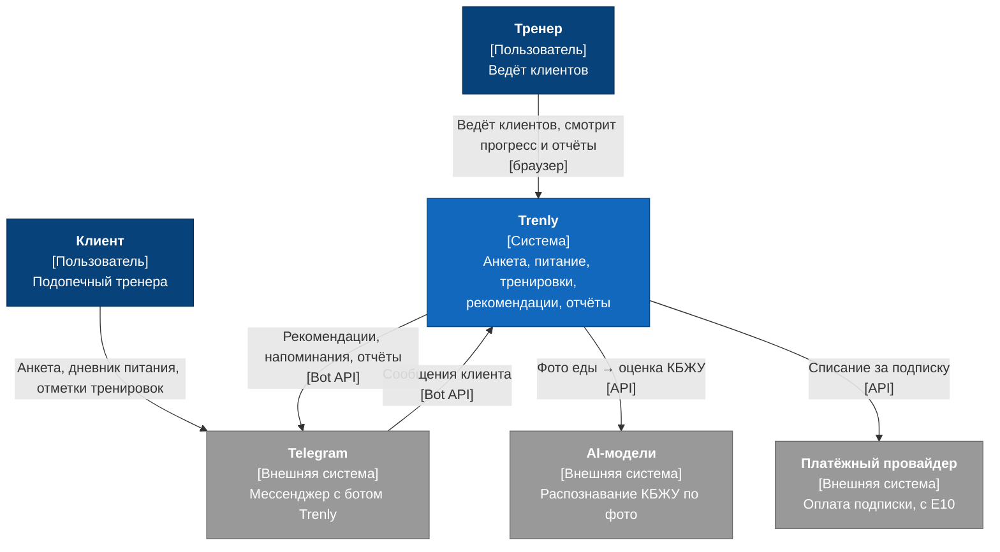

# Уровень 1. Контекст

Trenly — единая система, с которой работают тренер и клиент. Внутреннее устройство на этом уровне не показывается.

## Пользователи

| Пользователь | Описание | Как работает с Trenly |
|---|---|---|
| Тренер | Персональный фитнес-тренер. Платит за подписку (после пилота). | Веб-кабинет в браузере: клиенты, анкеты, питание, тренировки, отчёты |
| Клиент | Подопечный тренера, подключён ровно к одному тренеру. Бесплатно. | Только через Telegram-бота: анкета, дневник питания, отметки тренировок, рекомендации, награды |

## Система

| Система | Описание |
|---|---|
| Trenly | Взаимодействие тренера и клиента: подключение клиента, анкета, дневник питания с КБЖУ, тренировки и посещения, рекомендации, награды, журнал и отчёты, подписка тренера |

## Внешние системы

| Система | Зачем нужна | Взаимодействие | Когда появляется |
|---|---|---|---|
| Telegram | Канал клиента: через бота клиент отправляет данные и получает сообщения | Trenly ↔ Telegram Bot API | E3 |
| AI-модели | Распознавание КБЖУ по фото еды | Trenly → API провайдера моделей | E7 |
| Платёжный провайдер | Ежемесячное списание за подписку тренера | Trenly → API провайдера, уведомления об оплате → Trenly | E10 |

## Диаграмма

## Ключевые ограничения

- Персональные данные клиентов хранятся в РФ (152-ФЗ, [NFR-PRIV-003](../../nfr/privacy.md)).
- Передача фото во внешние AI-модели за пределами РФ — только после согласования с юристом ([NFR-PRIV-004](../../nfr/privacy.md)).
