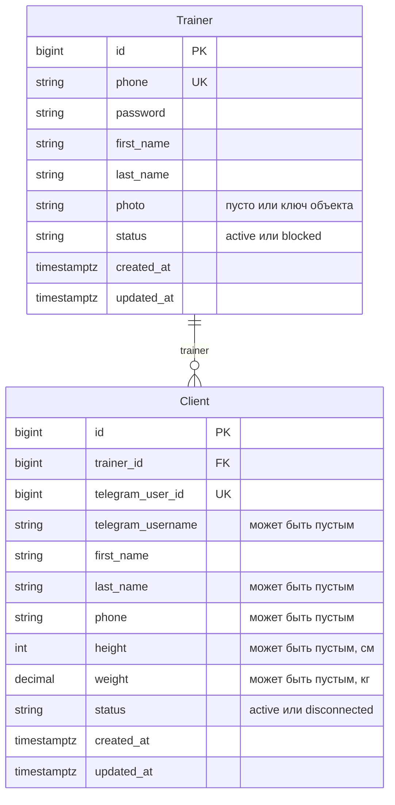

# Модель данных

Логическая схема доменных таблиц PostgreSQL. Диаграмма — источник правды по составу сущностей, полей и связей: любое изменение постоянных моделей обновляет этот файл в том же изменении.

Имена сущностей совпадают с колонкой «В коде» в [глоссарии](../glossary.md). Таблицы Django (`auth`, `admin`, `sessions`, `contenttypes`) здесь не показаны.

## Соглашения

Рост (`height`) хранится в сантиметрах, вес (`weight`) — в килограммах. Единицы измерения в имена полей не входят.

