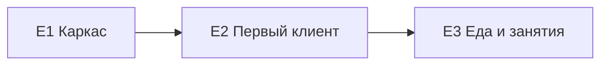

# Роадмап

Роадмап состоит из этапов. Один этап — один эпик. Эпик декомпозируется на одно или несколько изменений OpenSpec (см.
[процесс](../spec-driven-process.md)). Порядок определяется зависимостями; сроки не фиксируются.

На этих этапах тренеров заводит администратор. Роадмап повторяет [BR-001–BR-006](requirements.md). BR-007–BR-011 в этот
роадмап не входят.

## Этапы

- **Этап:** 1. Каркас. **Эпик:** E1. **Результат:** Стек выбран. Есть `backend/`, `frontend/` (кабинет, Mini App, клиент
  API) и `tg_bot/`. Локально они запускаются
- **Этап:** 2. Первый клиент. **Эпик:** E2. **Результат:** Тренер входит в кабинет, отправляет ссылку, клиент заполняет
  анкету, подтверждает тренера и оказывается в списке
- **Этап:** 3. Еда и занятия. **Эпик:** E3. **Результат:** Фото еды с КБЖУ, запись на занятие, экран «сегодня» в
  кабинете, Mini App клиента

## Эпики

- **ID:** E1. **Эпик:** Каркас. **Что входит:** Стек: Django и DRF, PostgreSQL, Vue 3, aiogram 3, aiogram_dialog 2.
  Папки `backend/`, `frontend/` (`dashboard/`, `miniapp/`, `api-client/`), `tg_bot/`. Локальный запуск, включая
  PostgreSQL и Redis. **BR:** —. **Зависит от:** —. **Части:** docs, backend, frontend, tg_bot
- **ID:** E2. **Эпик:** Первый клиент. **Что входит:** Администратор заводит тренера и задаёт телефон с паролем. Тренер
  входит в кабинет, создаёт ссылку и отправляет её клиенту. Клиент открывает ссылку. Бот по id приглашения получает
  тренера: id, имя, фамилию и аватар, клиента ещё не создаёт. Дальше бот собирает имя, фамилию, дату рождения, рост, вес
  и цель. В конце клиент подтверждает привязку к этому тренеру, и одним запросом Django создаёт клиента и привязывает
  его. Чужие клиенты тренеру недоступны. **BR:** BR-001, BR-002, BR-005, BR-006. **Зависит от:** E1. **Части:** backend,
  frontend, tg_bot
- **ID:** E3. **Эпик:** Еда и занятия. **Что входит:** Клиент отправляет фото еды в бота, OpenRouter считает КБЖУ,
  клиент подтверждает число или нет. Неподтверждённый расчёт в дневник не попадает: КБЖУ этого приёма клиент вводит
  вручную в Mini App. Тренер записывает клиента на занятие, за день бот спрашивает, придёт ли клиент. В кабинете на
  сегодня три состояния: подтвердил, ещё не ответил, отказался. В Mini App клиент видит тренировки по дням, КБЖУ за день
  и статистику посещённых тренировок. **BR:** BR-003, BR-004. **Зависит от:** E2. **Части:** backend, frontend, tg_bot

## Зависимости

E2 начинается после E1. E3 начинается после E2.
