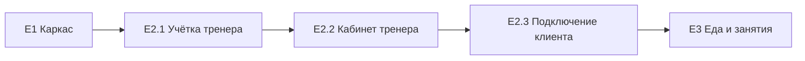

# Роадмап

Роадмап состоит из этапов. Этап объединяет один или несколько эпиков. Эпик декомпозируется на одно или несколько
изменений OpenSpec (см. [процесс](../spec-driven-process.md)). Порядок определяется зависимостями; сроки не
фиксируются.

На этих этапах тренеров заводит администратор. Роадмап повторяет [BR-001–BR-006](requirements.md). BR-007–BR-011 в этот
роадмап не входят.

Статусы этапов и эпиков: сделан, частично, предстоит.

## Этапы

- **Этап:** 1. Каркас. **Статус:** сделан. **Эпик:** E1. **Результат:** Стек выбран. Локально запускаются `backend/`,
  оболочка Mini App и клиент API, вместе с PostgreSQL и Redis. В `tg_bot/` установлены зависимости бота
- **Этап:** 2. Первый клиент. **Статус:** частично. **Эпики:** E2.1, E2.2, E2.3. **Результат:** Тренер заходит на сайт,
  авторизуется и попадает в личный кабинет. Кнопка «Пригласить клиента» выдаёт ссылку. Клиент открывает её в
  Telegram-боте, вводит имя, фамилию, рост, вес и цель занятий, подтверждает тренера и сохраняет анкету. Тренер видит
  нового клиента в списке
- **Этап:** 3. Еда и занятия. **Статус:** предстоит. **Эпик:** E3. **Результат:** Фото еды с КБЖУ, запись на занятие,
  экран «сегодня» в кабинете, Mini App клиента

## Эпики

- **ID:** E1. **Эпик:** Каркас. **Статус:** сделан. **Что входит:** Стек: Django и DRF, PostgreSQL, Vue 3, aiogram 3,
  aiogram_dialog 2. Папки `backend/`, `frontend/` (`miniapp/`, `api-client/`), `tg_bot/` с зависимостями. Локальный
  запуск `backend/` и Mini App, включая PostgreSQL и Redis. Пакет `frontend/dashboard/` и запускаемый процесс бота в
  этот эпик не входят. **BR:** —. **Зависит от:** —. **Части:** docs, backend, frontend, tg_bot
- **ID:** E2.1. **Эпик:** Учётка тренера. **Статус:** частично. **Что входит:** Администратор
  заводит тренера и задаёт телефон с паролем. Тренер входит в API кабинета телефоном и паролем, API выдаёт JWT.
  Список клиентов API отдаёт только своих. Веб-экран кабинета в этот эпик не входит. **BR:** BR-005, BR-006.
  **Зависит от:** E1.
  **Части:** backend
- **ID:** E2.2. **Эпик:** Кабинет тренера. **Статус:** предстоит. **Что входит:** Макеты входа и кабинета в Figma, затем
  пакет `frontend/dashboard/`. Тренер заходит на сайт, авторизуется и попадает в личный кабинет со списком своих
  клиентов. Чужие клиенты ему недоступны. **BR:** BR-005. **Зависит от:** E2.1. **Части:** frontend
- **ID:** E2.3. **Эпик:** Подключение клиента. **Статус:** предстоит. **Что входит:** Локально запускается `tg_bot/`.
  Макет кнопки «Пригласить клиента» в Figma, затем кнопка в кабинете выдаёт ссылку. Клиент открывает ссылку и попадает
  в бота. Бот собирает имя, фамилию, рост, вес и цель занятий. Клиент подтверждает тренера и сохраняет анкету. До
  подтверждения клиента в списке нет. После сохранения тренер видит его в списке. **BR:** BR-001, BR-002.
  **Зависит от:** E2.2. **Части:** backend, frontend, tg_bot
- **ID:** E3. **Эпик:** Еда и занятия. **Статус:** предстоит. **Что входит:** Клиент отправляет фото еды в бота,
  OpenRouter считает КБЖУ, клиент подтверждает число или нет. Неподтверждённый расчёт в дневник не попадает: КБЖУ этого
  приёма клиент вводит вручную в Mini App. Тренер записывает клиента на занятие, за день бот спрашивает, придёт ли
  клиент. В кабинете на сегодня три состояния: подтвердил, ещё не ответил, отказался. В Mini App клиент видит тренировки
  по дням, КБЖУ за день и статистику посещённых тренировок. **BR:** BR-003, BR-004. **Зависит от:** E2.3. **Части:**
  backend, frontend, tg_bot

## Зависимости

E2.1 начинается после E1. E2.2 начинается после E2.1. E2.3 начинается после E2.2. E3 начинается после E2.3.
