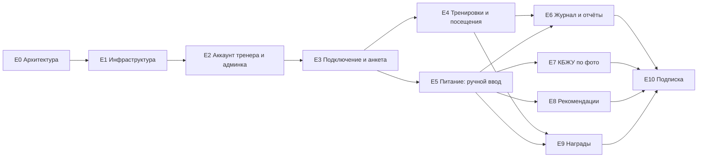

# Роадмап

Роадмап состоит из эпиков. Эпик декомпозируется на одно или несколько изменений OpenSpec (см. [процесс](../spec-driven-process.md)). Порядок определяется зависимостями; сроки не фиксируются.

Платная подписка реализуется последней: сначала сервис обкатывается на пилотных тренерах, которые пользуются им бесплатно.

## Этапы

| Этап | Результат | Эпики |
|---|---|---|
| 0. Фундамент | Архитектура согласована, монорепозиторий, CI и окружения готовы | E0, E1 |
| 1. Пилот | Пилотные тренеры бесплатно ведут реальных клиентов: подключение, анкета, тренировки, питание с ручным вводом, кабинет | E2–E6 |
| 2. Полный продукт | По итогам пилота: КБЖУ по фото, рекомендации, награды | E7–E9 |
| 3. Платный запуск | Пробный период и подписка, открытая регистрация тренеров | E10 |

## Эпики

| ID | Эпик | Что входит | BR | Зависит от | Части |
|---|---|---|---|---|---|
| E0 | Архитектура | Стек, C4, ключевые технические решения ([реестр ADR](../architecture/adr/README.md)) | — | — | docs |
| E1 | Инфраструктура | Каркас backend/ и frontend/, локальное окружение (БД, S3), CI/CD с фильтрами по путям, окружения dev/stage/prod, учётные записи тестового и боевого ботов в Telegram (код — `tg_bot/`, E3), логирование и мониторинг | — | E0 | backend, frontend |
| E2 | Аккаунт тренера и админка | Админка на Django Admin: администратор вручную добавляет и блокирует тренеров; вход тренера (на пилоте — без оплаты), каркас кабинета; тренер видит только своих клиентов | BR-009, BR-011 | E1 | backend, frontend |
| E3 | Подключение клиента и анкета | Ссылка/QR на бота, привязка клиента к одному тренеру, согласие на обработку данных, анкета с целью, отключение клиента | BR-002, BR-003 | E2 | backend, frontend, tg_bot |
| E4 | Тренировки и посещения | «Приду / не приду», отметка выполненных тренировок, уведомления тренеру, сообщения тренера клиенту, напоминания | BR-006, BR-008 | E3 | backend, frontend, tg_bot |
| E5 | Дневник питания: ручной ввод | Ввод КБЖУ, итог за день, дневник в кабинете | BR-004 (без фото) | E3 | backend, frontend, tg_bot |
| E6 | Журнал и отчёты | Автоматический журнал, карточка клиента, отчёт о прогрессе в кабинете и в боте | BR-009, BR-010 | E4, E5 | backend, frontend, tg_bot |
| E7 | КБЖУ по фото | Хранение фото, интеграция с AI-моделями, оценка по фото, исправление клиентом | BR-004 | E5 | backend, tg_bot |
| E8 | Рекомендации по питанию | Ежедневная рекомендация с учётом цели клиента | BR-005 | E5 | backend, frontend, tg_bot |
| E9 | Награды | Серии и достижения за регулярность | BR-007 | E4, E5 | backend, frontend, tg_bot |
| E10 | Подписка и пробный период | Самостоятельная регистрация тренера, пробный период, ежемесячная оплата, блокировка функций без подписки, режим просмотра для клиентов | BR-001 | E2–E9 | backend, frontend, tg_bot |

## Зависимости

После E3 эпики E4 и E5 идут параллельно; E7, E8 и E9 тоже независимы друг от друга. E10 начинается после пилота и доработок по его итогам.
