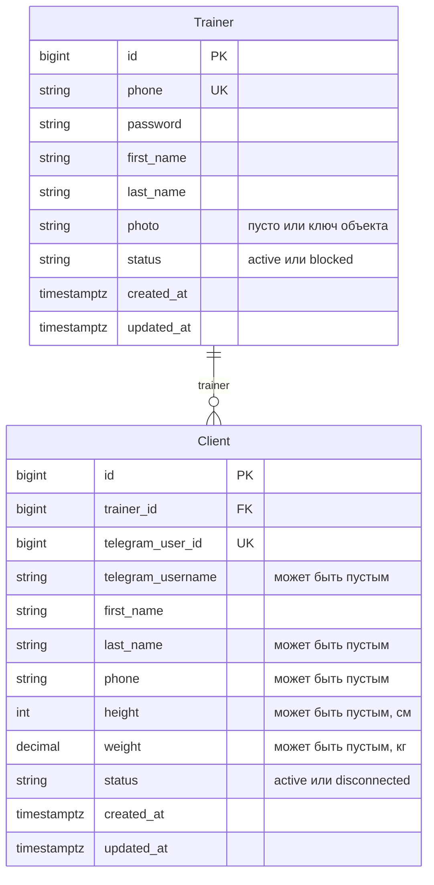

# Design

## Context

См. [proposal.md](proposal.md). В `backend/` уже есть Django, DRF и пустая OpenAPI-схема; `AUTH_USER_MODEL` не переопределён, аутентификация API выключена (`DEFAULT_AUTHENTICATION_CLASSES` пустой). Каталогов `frontend/` и `tg_bot/` нет. Object Storage в коде ещё не подключён; фото еды по [ADR 0002](../../../docs/architecture/adr/0002-photo-storage.md) появятся в E7 и живут 90 дней.

Поведение — в `specs/trainer-admin/spec.md` и `specs/trainer-dashboard/spec.md`.

## Goals / Non-Goals

**Goals:**

- Зафиксировать модели `Trainer` и `Client` и границу учёток: администратор входит в Django Admin, тренер — только в API кабинета.
- Описать контракт OpenAPI для входа и списка клиентов.

**Non-Goals:**

- Создание и отключение клиента, бот, ссылка и QR, анкета и цель.
- Экран кабинета: `frontend/` нет, его соберёт отдельное изменение по этой схеме.
- Подписка, пробный период, самостоятельная регистрация тренера.
- Выдача и удаление фото еды.

## Decisions

### Учётки разделены

Администратор — стандартный `django.contrib.auth.models.User` с `is_staff`. Тренер — модель `Trainer` со своим хешем пароля (`django.contrib.auth.hashers`) и теми же валидаторами, что `AUTH_PASSWORD_VALIDATORS`. `AUTH_USER_MODEL` не меняется.

Так телефон и пароль тренера не подходят к форме `/admin/`: она ищет только `User`. Общая модель с флагом `is_staff=False` хуже: флаг можно включить у тренера, и он попадёт в админку. Сделать тренера `AUTH_USER_MODEL` тоже хуже: тогда сотрудник Trenly был бы тренером.

Решение переживёт это изменение, поэтому его нужно записать отдельным ADR (следующий номер — 0007). Контейнеры C4 не меняются. Способ входа дописывается в пустой раздел «Аутентификация и авторизация» в `docs/nfr/security.md`.

### Телефон

В базе телефон хранится как `+7` и десять цифр. Перед сравнением и сохранением из ввода убираются пробелы, скобки и дефисы; ведущая `8` заменяется на `+7`. Другой формат форма отклоняет. У тренера поле уникально. У клиента поле необязательное и неуникальное: это контакт, не логин.

### Модели

Приложения Django — `trainers` и `clients`. Оба класса наследуют абстрактную модель `TimeStampedModel` с `created_at` и `updated_at`. Удаление тренера, у которого есть клиенты, запрещено (`PROTECT`): на пилоте тренера блокируют, а не стирают.

`Trainer`:

| Поле | Ограничение |
|---|---|
| `phone` | уникальный, нормализованный |
| `password` | хеш, в API и в списке админки не показывается |
| `first_name`, `last_name` | обязательные |
| `photo` | пусто или ключ объекта |
| `status` | `active` (по умолчанию) или `blocked` |

`Client` в админке не регистрируется.

| Поле | Ограничение |
|---|---|
| `trainer` | обязательная связь, ровно один тренер |
| `telegram_user_id` | обязательный, уникальный |
| `telegram_username` | пустое допустимо |
| `first_name` | обязательное |
| `last_name` | пустое допустимо |
| `phone` | пустое допустимо, та же нормализация |
| `height` | пустое или целое число сантиметров больше нуля |
| `weight` | пустое или килограммы с одним знаком после запятой, больше нуля |
| `status` | `active` (по умолчанию) или `disconnected` |

Публичного API для создания и изменения клиента в этом изменении нет. Строки появляются в тестах и в следующем подключении через бота. Список кабинета их только читает.

Диаграмма для `docs/architecture/data-model.md` (таблицу Django `auth_user` по-прежнему не показываем):

### Фото тренера

Админка принимает файл и сохраняет его по ключу `trainers/{id}/photo.jpg`. В поле `photo` лежит ключ, не содержимое. Новый файл заменяет предыдущий.

Хранилище — S3-совместимое, тот же подход, что в ADR 0002, но префикс `trainers/` и без правила удаления через 90 дней: портрет нужен, пока тренер есть. Локально и в тестах тот же ключ пишется в закрытый каталог на диске, чтобы не требовать бакет. Боевой бакет включается настройками окружения. Зависимость S3-клиента добавляется в `backend/`.

### Вход в кабинет

Отдельной таблицы сессий нет. `POST /api/trainer-sessions` принимает `phone` и `password`. При успехе отвечает `201` и телом `{"token": "<строка>"}`. Токен — подписанное Django значение с id тренера и сроком 14 дней.

Неизвестный телефон, неверный пароль и статус `blocked` дают один и тот же `401` без уточнения причины.

Дальнейшие запросы кабинета передают `Authorization: Bearer <token>`. Проверка каждый раз читает тренера и пускает только `active`. Поэтому блокировка обрывает уже выданный токен со следующего запроса. Глобальный `DEFAULT_AUTHENTICATION_CLASSES` остаётся пустым: схема и `/api/health/` публичные, админка живёт на сессии `User`. Класс аутентификации указан только на представлениях кабинета.

`GET /api/clients` для активного тренера возвращает `200` и массив только его клиентов, по `created_at` по возрастанию. Элемент: `id`, `first_name`, `last_name` (пустая строка, если фамилии нет), `phone`, `height`, `weight`, `status` (`active` или `disconnected`). Телефон, рост и вес — `null`, если не заданы. `telegram_user_id` и `telegram_username` в ответ не входят. Без токена, с плохим токеном или у заблокированного тренера — `401`.

Оба пути попадают в OpenAPI через drf-spectacular, вместе со схемой Bearer.

### Части репозитория

- **backend.** Приложение `trainers` (модель, админка, вход) и приложение `clients` (модель и список в кабинете), миграции, нормализация телефона, хранилище фото.
- **frontend.** Без изменений. Кабинет позже берёт контракт из `/api/schema/`.
- **tg_bot.** Без изменений. Боту пока нечего вызывать: клиента это изменение не создаёт.

### Админка

`ModelAdmin` тренера: список с телефоном, именем, фамилией, статусом и числом клиентов; поиск по телефону и имени. Пароль задаётся двумя полями формы и в базе хранится хешем. Модель `Client` в `admin.site` не регистрируется, чтобы персональные данные клиента там не открывались.

## Risks / Trade-offs

- [Токен не отзывается по одному, пока не истекли 14 дней или тренера не заблокировали] → для пилота достаточно: смена пароля редкая и делает её администратор; блокировка проверяется на каждом запросе.
- [Одинаковый `401` не говорит тренеру, что он заблокирован] → так кабинет не подтверждает, какие телефоны заведены. Текст для заблокированного можно добавить позже, если пилоту он нужен.
- [Фото локально лежит на диске, а не в бакете] → ключ в базе один и тот же; боевое окружение переключает хранилище настройкой. Префикс `trainers/` нельзя вешать на жизненный цикл фото еды.
- [Клиентов нечем создать, кроме тестов и будущего бота] → список в проде будет пустым до подключения. Это осознанная граница с E3.

## Migration Plan

Первая миграция приложения `trainers` на пустой базе. Откат — обратная миграция: таблиц с боевыми данными ещё нет. Токены подписываются текущим `SECRET_KEY`; его смена разлогинивает тренеров.

## Open Questions

Нет.
